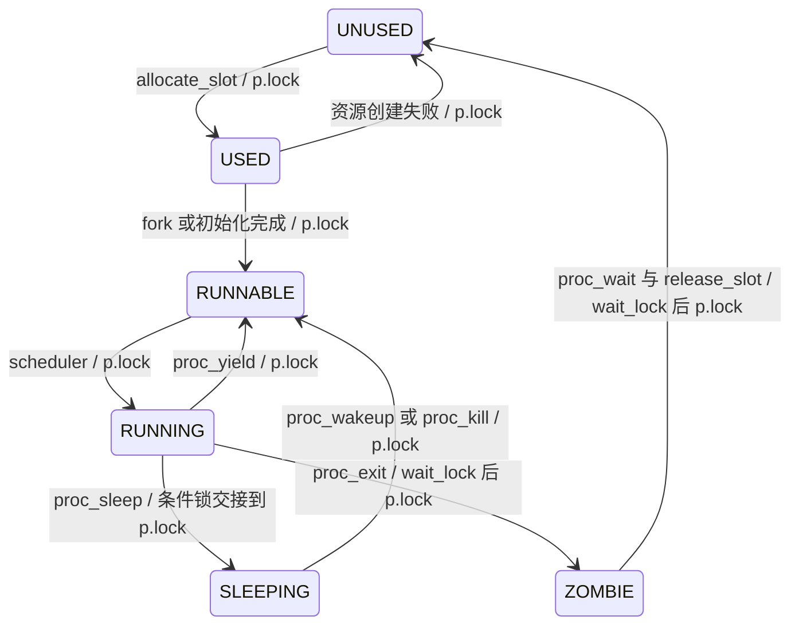

# lab4 设计与验收问答

本文覆盖实验说明书 V3（2026-10-09）、lab4-v2-20261009 的接口约定、三道思考题和现场追问。依据本仓库源码与 2026-10-19 的 QEMU 实测编写；个人理解仍需本人复核并练习口述。

## 目录

- [个性化参数速查](#个性化参数速查)
- [起点差距与系统主线](#起点差距与系统主线)
- [任务书思考题](#任务书思考题)
- [设计决策与失败回滚](#设计决策与失败回滚)
- [现场三题速答](#现场三题速答)
- [高频追问](#高频追问)
- [故障现象与日志定位](#故障现象与日志定位)
- [实现范围与待本人完成事项](#实现范围与待本人完成事项)

## 个性化参数速查

| 参数 | 本人值 | 实际作用 |
| --- | ---: | --- |
| 学号 | 2024302141121 | 个性化参数唯一来源为 course_sid.h |
| LAB4_POLICY_ID | 1 | 三级 MLFQ；宏旁旧“彩票”注释不适用，以 V3 分配表为准 |
| LAB2_TICK | 3 | 每次机器时钟间隔为 100000×3 个 time 计数 |
| 队列及时间片 | level 0/1/2；1/2/4 tick | 数字小的队列优先；耗尽后下降一级，最低级保持 |
| 默认 tickets | 7 + 学号 % 13 = 7 | setickets 可覆盖，MLFQ 记录此值但不作为优先级 |
| NPROC | 64 | 使用预置 param.h；原 lab3 自定 8 槽不能容纳 bench 的 shell+父进程+8 子进程 |
| 进程内核栈 | 每槽 8 KiB | 静态预留、恒等映射；复用槽位时复用该栈 |
| 调度器栈 | boot_stack，12 KiB | main 进入 scheduler 后一直保留，与进程内核栈分离 |
| 统计口径 | 仅用户态时钟中断 | 内核态时钟推进全局 ticks，但不计 cpu_ticks、不抢占内核 |

时钟口径根据 [start.c 时钟周期](../../labs/2024302141121-kernel/kernel/start.c#L48) 核实：LAB2_TICK 已乘进硬件周期，不能再把最高级片长设为 3，否则会重复乘三。以 QEMU virt 的 10 MHz time 计数推算，1 tick 约为 30 ms；实际测试用 time_rdtime 与 pause 对齐校准，不把主机耗时当作 tick。计数点见 [proc_tick](../../labs/2024302141121-kernel/kernel/proc.c#L335)。

## 起点差距与系统主线

| 项目 | lab3-submit 的实际实现 | lab4 的实现 |
| --- | --- | --- |
| 当前进程与上下文 | 全局 current；在外层 trap 边界改 current；没有 C 续体 | cpus[hart].proc 与 context；swtch 保留各自 C 调用栈 |
| 进程表锁 | 只靠单核关中断串行，不是全局 ptlock | 每进程 p->lock；wait_lock 管父子关系；pid_lock 分配 PID |
| 关中断嵌套 | 无自旋锁嵌套结构 | cpu.noff/intena 与持锁 CPU 归属 |
| 让出 CPU | usertrap 时钟分支每拍切进程；阻塞 ecall 回退 epc 重试 | 满个人时间片 proc_yield；sleep 后从原调用位置继续 |
| 调度顺序 | 固定扫描；8 个槽位 | 三级优先扫描，每级独立轮转游标；64 个槽位 |
| 休眠 | PROC_INPUT/PROC_SLEEP/PROC_WAITING 等专用状态 | 统一 SLEEPING+chan；条件锁与进程锁交接 |
| wait/exit | 子退出时可能立即代父回收 | exit 置 ZOMBIE；父 wait 在子已离开内核栈后回收 |

旧实现位于 lab4-start，不能把常见的 ptlock/sched_ctx 方案写成自己旧代码的事实。本轮保留编译开关 LAB4_RR_TEST，在临时副本独立验证轮转机制；正式树默认启用 MLFQ。轮转副本 bench 和 alt 均通过。

### 进程状态机



USED 表示资源尚未公开的槽位，不能被调度。fork 建页表失败沿 release_slot 回到 UNUSED。状态与本进程调度数据由 p->lock 保护；父子关系由 wait_lock 保护。源入口：[allocate_slot](../../labs/2024302141121-kernel/kernel/proc.c#L76)、[scheduler](../../labs/2024302141121-kernel/kernel/proc.c#L275)、[proc_wait](../../labs/2024302141121-kernel/kernel/proc.c#L395)、[proc_exit](../../labs/2024302141121-kernel/kernel/proc.c#L420)。

### 完整切换路径

```text
A 用户栈
  -> uservec：31 个用户寄存器存入 A.trapframe，换内核页表和 A 内核栈
  -> usertrap -> proc_tick -> proc_yield -> sched
  -> swtch(A.context, cpu.scheduler)：保存 ra/sp/s0-s11，换到 boot_stack
调度器栈
  -> scheduler 从 swtch 返回，清 cpu.proc，释放 A.lock
  -> 持 B.lock，设 B RUNNING，cpu.proc=B，清 B.last_slice_ticks
  -> swtch(cpu.scheduler, B.context)，换到 B 内核栈
B 内核栈
  -> 老进程：从其 sched 返回；新进程：forkret 先释放 B.lock
  -> usertrapret -> userret：换用户页表，恢复用户寄存器，sret
B 用户栈
```

trampoline 只负责特权级往返；scheduler 不在用户页表下执行。[struct cpu](../../labs/2024302141121-kernel/kernel/proc.h#L54) 记录调度器 context 和当前进程；[sched](../../labs/2024302141121-kernel/kernel/proc.c#L311) 检查锁不变式；[forkret](../../labs/2024302141121-kernel/kernel/proc.c#L323) 处理新进程第一次进入；[usertrapret](../../labs/2024302141121-kernel/kernel/trap.c#L142) 填写 kernel_satp/sp/trap/hartid。

## 任务书思考题

### 1. swtch 只保存 14 个寄存器，且不显式保存 PC，为什么仍能正确切换回来？完整保存 31 个通用寄存器是否可行，代价是什么？

**一句话：正常 C 调用把返回点放在 ra，swtch 恢复 ra 后 ret 就回到另一条内核续体；C 调用约定已经保护了调用者的活跃临时值。**

参数 old/new 在 a0/a1。预置 [swtch.S](../../labs/2024302141121-kernel/kernel/swtch.S#L9) 依次保存并恢复 ra、sp、s0–s11，偏移为 0、8、16…104，结构大小 112 字节，C 结构及编译期检查分别见 [struct context](../../labs/2024302141121-kernel/kernel/proc.h#L51)、[context ABI 检查](../../labs/2024302141121-kernel/kernel/proc.c#L29)。调用 swtch 的 call 指令已经产生“调用后的 PC”，所以无须另存 PC；第一次调度没有旧返回点，allocate_slot 把 ra 设为 forkret，sp 设为本进程内核栈顶。

a0–a7、t0–t6 属于 caller-saved，编译器知道 swtch 是普通外部调用，会把跨调用仍需使用的值保存在栈或 s 寄存器中。gp 为共用内核全局指针；tp 为当前 CPU 身份，不能当作普通进程现场盲目恢复。严格说 ra 在 ABI 中属于 caller-saved，但此特殊汇编为恢复续体必须显式保存它。

保存更多寄存器可以设计成另一种 ABI，但需要同步修改结构与汇编；31 个寄存器约 248 字节，比 112 字节更费空间和访存，也必须小心 gp/tp 的特殊语义。trapframe 对应任意用户指令被打断，不能假定用户已经按调用约定保护 caller-saved，因此要保存完整用户现场。若 context 排列错一项，恢复的栈或返回地址错位，通常第一次 fork 后即异常跳转。

### 2. 从进程 A 的用户态切到进程 B 的用户态，依次经过哪些栈？每个切换点由哪段代码（trampoline.S / swtch.S / 调度器）完成？

**一句话：A 用户栈 → A 内核栈 → CPU 调度器栈 → B 内核栈 → B 用户栈。**

uservec 从 trapframe 的 kernel_sp 取 A 内核栈，进入 usertrap；sched 的 swtch 加载 cpu.scheduler.sp，进入独立 boot_stack。scheduler 选择 B 后再用 swtch 恢复 B.context.sp；B 从 sched 或 forkret 接着运行，userret 恢复 B.trapframe.sp 返回用户栈。对应源码见上方“完整切换路径”。

调度器不能继续在 A 内核栈上访问 A 的执行现场并同时允许回收该栈。当前栈虽为静态保留，wait 仍要等 A 真正 swtch 离栈后才复用槽位；这条规则也为后续动态内核栈回收留下安全边界。若在离栈前释放 p->lock，其他执行流可能把同一槽位再次调入，两个执行流共用栈。

### 3. 如果 sleep 在未获取 p->lock 的情况下先释放外部锁、再修改状态，构造一个具体的交错序列，使该进程永久阻塞。

**一句话：父进程检查子进程还没退出后松开条件锁，子进程恰好退出并唤醒，父进程尚未 SLEEPING 而错过唤醒，随后睡死。**

```text
父 A                              子 B
持 wait_lock，未找到 ZOMBIE
错误地 release(wait_lock)
                                  取得 wait_lock
                                  wakeup(A)：A 仍是 RUNNABLE/RUNNING，未唤醒
                                  B=ZOMBIE，释放 wait_lock，sched
取得 A.lock，A=SLEEPING，sched
此后没有其他子进程再退出，A 永远等不到本次事件
```

正确 [proc_sleep](../../labs/2024302141121-kernel/kernel/proc.c#L350) 先取得 A.lock 再释放 wait_lock。唤醒者取得条件锁后还必须取得 A.lock；因此只能在 A 已写 SLEEPING 并切走后完成唤醒。返回时先清 chan、放 A.lock，再重新取得条件锁，由调用者的 while 复查条件。

2026-10-19 在临时副本实测：交换锁序、插入 1000000 次空转，再在 wait 的窗口主动 proc_yield 强制子进程运行。bench 未输出第一条 RESULT；Ctrl-P 显示 sh 与 bench 为 SLEEPING、bench 子进程为 ZOMBIE，见 [复现证据](evidence/lab4-lost-wakeup.txt)。该副本已移除，正式代码保持正确顺序。

这里不能声称“只加延迟便在本机复现永久阻塞”：本轮仅在用户态时钟中断抢占，内核延迟不会自动让另一进程运行。因此用 proc_yield 控制交错，而不是把没有观察到的现象写成实测。单核仍可能在释放条件锁的间隙遇到硬件生产者，所以生产代码必须遵守同样的锁交接规则。

## 设计决策与失败回滚

### 调度数据与队列表示

选择在 struct proc 内放 cpu_ticks、last_slice_ticks、tickets、mlfq_level、chan、context 与锁。这样槽位生命周期与策略数据的初始化/回收相同；独立调度表需要额外维护 PID 或槽号对应关系，容易留下复用后的旧数据。

本轮采用进程表扫描实现逻辑队列：先找 level 0，再找 1、2，每级从自己的 rr[level]+1 循环扫描；取得候选 p->lock 后保持到 swtch 返回，避免脱锁后被重新分配。最大约扫描 3×64 个槽位。显式链式队列可减少扫描，但需同时维护进程状态与队列成员关系，并增加队列锁顺序问题；本实验规模选择扫描方案。

> 💭 实测过一个反例：只用一个全局 rr 游标时，高级采样父进程每次醒来都会重置低级扫描起点，三个计算子进程曾出现 179:3:3 的 CPU 计数（见 evidence/lab4-fairness-before.txt）。每级独立游标修复后，统一预热窗口内三者差分为 64:64:64。公平性必须跨高低队列干扰验证，不能只看两个计算进程能不能轮流输出。

初建进程及 fork 子进程从 level 0、CPU/片长 0、默认 tickets=7 开始，不继承父进程已经下降的队列或累计统计；fork 复制名字。exec 成功后更新名字并回到 level 0，累计 cpu_ticks 保持进程生命周期口径。票数设置在 exec 后保持；MLFQ 只记录票数。

### 时间片与主动休眠

[proc_tick](../../labs/2024302141121-kernel/kernel/proc.c#L335) 仅在 usertrap 的时钟分支调用：先 cpu_ticks++、last_slice_ticks++，达到 1<<level 才降级并 yield。sleep 不降级，wakeup 保持原级。每次真正切入前 scheduler 清 last_slice_ticks；它表示最近一次连续运行的用户态 tick 数，不是全局 uptime，也不是运行时间的浮点百分比。

若每拍无条件 yield，较低级每次都被清零，只会观测到 1 tick。当前纯计算观测用三个伴随进程保留已完成片长，先观测档位再用统一预热后的 48 次采样验证同级公平性；不能依赖单个子进程立即被重新调入后的片长值。

只在用户态时钟到达时抢占，内核长计算不被抢占。被唤醒的高级交互进程在当前低级时间片结束后获得 CPU；一个低级竞争者下实测最大间隔 4 tick，测例允许 5 tick。该界限不应外推为任意数量高级竞争者下的实时保证。

> 💭 保留单核、用户态抢占是有边界的设计选择。旧 schedtest 的 uptime 高频查询会让不少时钟命中内核态，不能据此认定用户态抢占失效。本轮扩大查询间的纯计算量，仍要求子进程先于父进程 wait 执行；alt 另用不调用 pause 的纯计算负载证明抢占。

### 锁、关中断和交接

锁实现见 [spinlock.c](../../labs/2024302141121-kernel/kernel/spinlock.c#L13)。acquire 先 push_off，再原子 test-and-set，记录 owner=mycpu；release 校验归属，清 owner、解锁，再 pop_off。noff 只在最外层保存/恢复 intena，不会因释放内层锁就提前开中断。

sched 四条断言：持有 p->lock、noff==1、状态不是 RUNNING、中断已关闭。切换前保存 intena、恢复后写回，因为另一个进程可能在同一 CPU 上改写它。p->lock 跨 swtch 交接：进程切走后由 scheduler 释放；调度器切入后由恢复的进程释放；新进程由 forkret 释放。

条件锁统一先于 p->lock：wait_lock、tickslock、input_lock 的持有者调用 sleep 时先取得自己的 p->lock，再释放条件锁。wakeup 遍历时跳过 current，避免对自己的锁重入。退出路径必须一直保留 cpu.proc，只有 scheduler 在 swtch 返回后清空它。

### wait、exit 和资源回滚

wait_lock 保护父子关系及检查/休眠原子性；wait 扫描孩子时再取得孩子锁。exit 先持 wait_lock，给孤儿重新指派 initproc，唤醒父进程，再持自身锁写退出码与 ZOMBIE；放 wait_lock 后只持自身锁进入 sched。父进程醒来须重新扫描，支持先退出、后 wait 的情况。

wait 的状态地址先验证，错误返回不会回收孩子。正常回收先受控 copyout 写退出码，再 release_slot：释放用户页、页表页、trapframe，保留 p->lock 对象，只清它后面的槽位数据。静态内核栈不进入 kalloc，不应在 kfree_count 中要求它随每次退出增减；它在真正离栈后随槽位复用。

fork 仍使用 lab3 深拷贝和映射失败回滚，失败子槽不进入 RUNNABLE。新槽初始化失败会释放已分配资源及槽锁。exec 保持“新地址空间全部成功后提交”，失败保留旧空间。进程表满时 fork 返回 -1；SCHEDABI 在 shell+测试本身之外确实创建 62 个孩子，杀死并回收后再次 fork 成功。测试前后空闲页 32527→32527。

> 💭 release_slot 不能对整个 struct proc 执行清零：调用者此时正持有 p->lock，清掉 locked/owner 会让随后的 release 报错，也可能让其他执行流提前进入。这里从 context 字段起清零，保留锁实例，并用满表回收和重复 fork 测试槽位复用。

### 观测、时间和 kill

[proc_schedstat](../../labs/2024302141121-kernel/kernel/proc.c#L441) 先验证两个用户输出范围，再持目标锁读两个计数，释放目标锁后 copyout。pid=-1 查自己；未知 PID、USED、ZOMBIE、已回收目标均失败；可查询其他存活进程。跨页由 lab3 copyout 逐页检查，不能直接解引用用户指针。控制台 read 也使用条件锁+sleep 保留已读字节计数，见 [console_read](../../labs/2024302141121-kernel/kernel/console.c#L161)。

[syscall 23/24/25](../../labs/2024302141121-kernel/kernel/syscall.c#L118) 分发 23/24/25；time_rdtime 返回 r_time，不是 ticks。pause 由 tickslock 保护，记起点后循环 sleep(&ticks,&tickslock)，用 ticks-start 判定经过拍数，见 [ticks_pause](../../labs/2024302141121-kernel/kernel/trap.c#L86)。kill 只设置 killed，睡眠目标改为 RUNNABLE；pause、read、wait 复查标志，返回用户态前统一 proc_exit(-1)。不能直接 kfree 目标：它可能还在运行、持锁或使用自己的栈。

### 其他策略的设计问题如何回答

本人 ID=1 不实现彩票、步长和优先级，不能用这些策略的比例测试评价 MLFQ。若设计彩票，可用带锁种子的线性同余发生器，使用正票数总和抽签；0 总票数应回退轮转或保持空闲，不能模 0。若设计步长，新建/唤醒进程的 pass 可对齐当前活跃队列最小 pass，以免从 0 长期独占。它们是任务书讨论的可选方案，不是本轮实测功能。

## 现场三题速答

1. **为什么不保存 PC？** swtch 是正常调用，ra 是调用后的续体地址，恢复 ra 后 ret；新进程用预设 forkret。trapframe 的 epc 才是用户被打断的 PC。
2. **为什么 p->lock 不能在 swtch 前放？** 状态已可运行但旧执行流还没离开内核栈；必须把状态变更与离栈作为一个临界区，并把锁交给另一条执行流释放。
3. **为什么先取 p->lock 再放条件锁？** 唤醒方也要取 p->lock，交接期间不会观察到“条件已变化但进程尚未休眠”的无保护窗口，醒来后仍要 while 复查条件。

## 高频追问

- **为什么三级、为什么 1/2/4？** ID=学号%10=1，V3 分配三级；LAB2_TICK 已用于周期倍数，最高级是一拍，逐级翻倍。
- **tickets=7 为什么改成 100 不多跑？** 本人是 MLFQ；接口成功保存票数，但选择逻辑按 level 和每级游标。
- **同级轮转为何要每级一个游标？** 共用游标会被频繁醒来的高优先级进程干扰，已用反例验证。
- **forkret 为什么先解锁？** 第一次调入没有经过 sched 返回，但 scheduler 带着 p->lock 调入，必须由 forkret 完成同样的交接。
- **c->intena 和 noff 分别是什么？** 前者为最外层关中断之前的状态；后者为当前 CPU 的关中断嵌套深度；跨进程续体恢复时 intena 必须恢复。
- **wfi 为什么不会永久阻塞串口？** scheduler 每轮短暂开中断处理待决事件；无就绪进程时关中断执行 wfi，待决中断能唤醒 CPU，再经下一轮开中断处理。已通过空闲 Shell 与 pause 唤醒实测。
- **唤醒就一定满足条件吗？** 不一定，kill 或多个读者都可能使目标再次运行，sleep 返回后必须在条件锁下循环检查。
- **schedstat 的 last_slice=0 是错了吗？** 刚调入时会清零；用户态尚未遇到时钟也可能一直是 0。单纯读系统调用次数不是 CPU tick。
- **bench 到底是 16 轮还是 100 轮？** V3 某段叙述残留 16，实际 v2 bench.c 的 ROUNDS=100，NCHILD=8，输出为 PASS: bench；以随包源码为准。
- **能否用后台 spin 加命令测抢占？** 预置 sh 没有 & 解析，spin 不退出；使用自写 alt 或 concurrent，不改预置 sh。
- **双核能直接启动吗？** 当前只放行 Hart 0；分核启动栈、每核时钟/PLIC、初始化屏障、分配器跨核互斥、调度游标一致性仍需另做，不能宣称双核完成。
- **后续 lab5 改哪里？** fork 深拷贝改 COW、缺页恢复挂 usertrap、引用计数与 copyout 写入需协调；当前仍为 EAGER，LAZY 请求暂按 EAGER 处理。

## 故障现象与日志定位

| 现象 | 首查位置 |
| --- | --- |
| sched p->lock / locks | 四条断言；是否仍带条件锁切走；forkret 是否释放正确锁 |
| 首次 fork 后异常地址 | context 112 字节与 swtch 0…104 偏移、ra/sp 初始化 |
| 只出现 1 tick 片长 | 是否每拍 yield；是否采样前已被重新调入清零 |
| 同级进程饥饿 | 每级独立游标；是否被高级采样父进程重置扫描起点 |
| bench 无第一条 RESULT | wait/exit 的 wait_lock→p.lock 顺序与丢失唤醒 |
| 有 ZOMBIE 但父进程一直睡 | 看复现日志，核对 sleep 交接窗口和父进程 chan |
| pause 立即返回或永久睡眠 | tickslock、wakeup(&ticks)、机器时钟转 S 软件中断链路 |
| Ctrl-P 空闲时没有 dump | idle 时 cpu.proc 为空，应回退到 initproc 页表 |
| 退出后空闲页减少 | 子页表/用户页/trapframe 的释放，不能清掉仍持有的锁 |

先用 -d int 过滤 async:0，再排除正常的 cause=8 ecall；用户坏地址测试本来会产生预期异常，正常 hi/badecall 会话才要求其他同步异常为 0。用 objdump/addr2line 把 epc 或 stval 回溯到源码，不使用 gdb。命令见 [验收清单](test-plan.md)。

## 实现范围与待本人完成事项

已实现：单核完整内核续体调度、每进程锁、标准休眠/唤醒、三级 MLFQ、pause/kill/观测接口、wait 退出码、Ctrl-P 快照及官方/自写/回归测试。

本轮未采用周期性全局优先级提升或老化。持续产生高级负载时低级可能等待很久；任务书对 ID=1 未要求防饥饿，不能把当前实现表述成含老化的 MLFQ。内核栈仍静态分配、没有独立内核栈 guard；不包含双核加分、COW、真正 LAZY 分配或文件系统。

待本人完成：复核本设计底稿，能现场从源码解释三题；在 lab0 手绘时钟图上用不同颜色标记实际“机器时钟→S 软件中断→用户抢占→调度器栈→另一进程”的链路。电子材料不能替代本人的手绘与口述。
